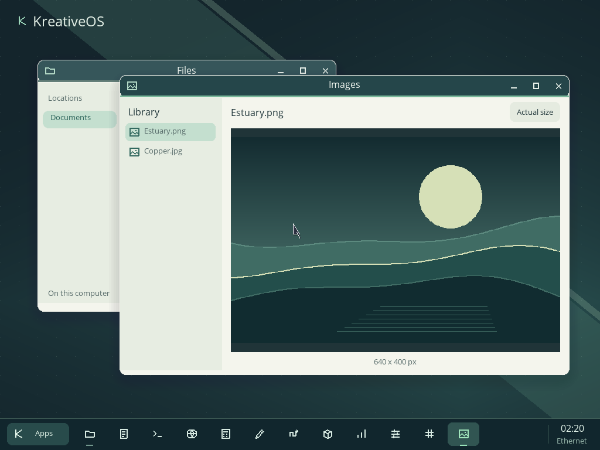

# KreativeOS

KreativeOS is an independent x86-64 operating system written from scratch in Rust. It boots through UEFI, exits firmware boot services, and runs its own graphical desktop, input drivers, disk storage and Ethernet stack. The kernel runs directly on x86-64. The browser uses Rust libraries for TLS and certificate validation.

## Download

[Download the compiled KreativeOS boot bundle](dist/KreativeOS-x86_64.zip?raw=true). It includes the boot disk, blank data disk, EFI binary, checksums, serial log and captured desktop. Extract the bundle into `build/` to use `scripts/run.sh`.



## Build and boot

Install stable Rust with the `x86_64-unknown-uefi` target, and Python 3:

```sh
rustup target add x86_64-unknown-uefi
bash scripts/build.sh
```

The build produces `build/KreativeOS.img`, a 64 MiB partitioned UEFI boot disk, `build/esp/EFI/BOOT/BOOTX64.EFI`, and separate 8 MiB IDE, SATA and NVMe data images. Existing data images are preserved on rebuild.

For QEMU, install `qemu-system-x86` and `ovmf`, then run:

```sh
bash scripts/run.sh
```

On Windows, install stable Rust, Python 3 and QEMU, then run from PowerShell:

```powershell
rustup target add x86_64-unknown-uefi
.\scripts\build.ps1
.\scripts\run.ps1 -Headless
```

The headless launch writes serial output to `build/serial.log`. Omit `-Headless` to open the desktop. Set `KREATIVE_PYTHON` or `KREATIVE_QEMU` to the executable path if automatic discovery fails.

Use `.\scripts\run.ps1 -Storage SATA -Headless` on Windows or `STORAGE=sata bash scripts/run.sh -display none` on Linux to use the native AHCI driver. Both commands attach the same type of data image used by the bare-metal driver.
Use `.\scripts\run.ps1 -Storage NVME -Headless` or `STORAGE=nvme bash scripts/run.sh -display none` for the native NVMe driver.

Set `OVMF_CODE` and `OVMF_VARS` if your firmware files use different paths. The supplied machine uses 256 MiB RAM, standard VGA, PS/2 input, RTL8139 Ethernet, a VirtIO boot disk (read by UEFI), and an IDE primary-master data disk. The operating system contains no Linux components; Linux, macOS or Windows can be used as a build host.

GitHub Actions compiles the Rust binary, boots the disk image in QEMU, and checks HTTPS against local TLS servers. It uploads the images, serial logs and desktop screenshot as `KreativeOS-x86_64`.

## Desktop

- tiny-skia vector icons, a composited pointer, antialiased Open Sans, an aurora wallpaper, and a three-column app launcher with workspace search. Click 1–4 at the top right to switch workspaces. Windows support dragging, minimizing, maximizing and closing.
- PS/2 keyboard, standard PS/2 mice, and IntelliMouse-compatible scroll wheels.
- Files and Notes with a persistent, checksummed, two-snapshot KFS volume.
- Terminal with file operations, app launching, network status, calculation and reboot.
- HTTP and HTTPS browser with DNS resolution, local HTML documents, inline images and WAV playback over HTTPS.
- Calculator with checked integer arithmetic, operator precedence and parentheses.
- Images opens PNG, JPEG and uncompressed BMP at fit or actual size. The gallery imports packs from the boot disk and firmware-mounted USB storage.
- Paint with a color palette, continuous strokes and clear canvas.
- Snake with food, scoring, self-collision, wall collision and restart.
- Two-player Tic Tac Toe with turn management, win detection and restart.
- Local KAPP1 document packages, installation persistence and a launcher entry.
- Separate Ethernet and ESP-AT Wi-Fi panels. Ethernet shows link speed, the active IPv4 configuration and remaining DHCP lease time, and saves automatic or manual profiles with a VLAN setting.
- Hardware Center shows the processor, active storage and Ethernet drivers, a searchable PCI inventory, and KFS usage. Use **Save report** to export the inventory to `Hardware.txt`.
- Settings with three accent colors, save-all and restart.

F1–F10 open Files through Settings. Escape toggles the launcher. Tab switches open windows. Drag the title bar to move a window. Use the controls on the right to minimize, maximize or restore, and close. In Notes, click Save. In Browser, press Ctrl+L to clear the address, then type an address and press Enter; use Up/Down to scroll. Snake uses arrow keys and Space to restart.

## Networking and hardware

Ethernet requests an IPv4 lease automatically on boot. It renews with the original DHCP server and broadcasts a rebind request if renewal fails. Network → Ethernet can save an automatic or manual profile to the data disk. Use VLAN 0 for an untagged network and `0.0.0.0` for an unused gateway or resolver in manual settings. The QEMU user network normally assigns `10.0.2.15/24`, gateway `10.0.2.2`, and DNS `10.0.2.3`.

Ethernet supports PCI RTL8139 and Intel 82540EM, 82544GC, 82545EM, and 82574L. QEMU defaults to RTL8139. Set `NIC_MODEL=e1000` for 82540EM or `NIC_MODEL=e1000e` for 82574L. The stack implements Ethernet, ARP, IPv4, UDP DNS with CNAME resolution, and a single bounded TCP/HTTP connection with retransmission and timeouts. DNS is IPv4 only. It reports truncated UDP replies and does not retry them over TCP.

Open `https://example.com/` in Browser or `file:Readme.html` for the bundled local document. The browser shows page text, the first compatible HTML image and a Play sound button for the first WAV audio source. Direct HTTPS links to PNG, JPEG, BMP and WAV also open. Media responses are capped at 768 KiB. HTTP uses port 80 and HTTP/1.0 connection-close semantics. HTTPS uses TLS 1.3 and checks the certificate chain, hostname and validity dates against the guest clock and the bundled Mozilla roots. It requires an x86 CPU with RDRAND, enabled by the supplied QEMU configuration. The browser supports authenticated HTTPS redirects and chunked response bodies. Plain HTTP uses the Ethernet interface.

The graphical desktop uses a cooperative event loop and polled drivers. KR3 programs enter CPU ring 3 in separate address spaces. Paint content stays in memory. KAPP packages contain document apps.

## Wi-Fi and sound

Connect an ESP32 running Espressif ESP-AT to COM2 using a UART adapter appropriate for the board and the PC port. The driver uses 115200 baud, 8 data bits, no parity and one stop bit. In **Network** enter the SSID and password, then select **Connect**. The module associates and gets its own IP address. HTTPS then uses the module's TCP transport with certificate and hostname checks inside KreativeOS.

QEMU can attach an ESP-AT serial backend with `ESP_AT_SERIAL`. The integration check uses a local protocol fixture for this serial transport.

The browser plays 16-bit PCM WAV through Intel ICH AC'97. QEMU adds the audio controller at boot. Set `AUDIO_SPEC=driver=pa` or another backend supported by your QEMU install if you want to select the host audio output explicitly.

## Import your images

Copy PNG, JPEG or uncompressed BMP files into an `imports/` directory at the repository root and rebuild the boot image. On boot, open **Images** from the taskbar. Use the arrow keys or mouse wheel to browse, and press Space to switch between fit and actual size.

To import from USB, create a pack with the included script and put `IMAGES.KIP` in the root of a FAT-formatted USB drive. Connect the drive before boot.

```sh
python3 scripts/pack_images.py photo.jpg drawing.png
```

The gallery reads up to 36 imported images from packs totaling 6 MiB. Each image can be up to 4,096 pixels on either side, with a total of 2,621,440 pixels.

## Files and packages

KFS has 24 file entries, 32-byte ASCII names and 2 KiB per file. It stores snapshots in sectors 2048–2247, committing the header last. KreativeOS looks for marked NVMe media first, then marked AHCI SATA media, then a dedicated legacy primary-master ATA disk. It mounts one data volume. Unrecognized nonblank KFS snapshots are rejected. A missing disk leaves files available in memory, and Save reports that state.

### SSDs, HDDs and data migration

Use `build/KreativeOS-sata.img` with a SATA SSD or HDD and `build/KreativeOS-nvme.img` with an NVMe SSD. For a physical PC, use UEFI boot and an AHCI controller for SATA drives. Put the boot image and data image on **separate dedicated media**. Both native drivers require 512-byte logical sectors, including drives with 4 KiB physical sectors that expose 512-byte logical sectors. A marked disk can be larger than the image. The drivers check the marker and a blank sector 0 before selecting a volume and limit writes to the KFS snapshot and draft areas.

To copy legacy files and accounts to a new SATA image while keeping the original image:

```sh
python scripts/sata_image.py build/migrated-sata.img --from-ide build/KreativeOS-data.img
```

Set `KREATIVE_DATA_IMAGE` to the new image and select the SATA launch profile. The migration script refuses to overwrite an existing output file. See [hardware research](docs/hardware.md) for the driver design and compatibility boundaries.

Add `--nvme` to that command to create a new NVMe image from the legacy IDE image. Existing marked SATA images also work with the NVMe profile. To move an existing SATA volume, make a copy of its image and point `KREATIVE_DATA_IMAGE` at the copy.

Terminal examples:

```text
help
ls
edit Ideas.txt
cat Welcome.txt
calc (12 + 8) * 3
browse http://example.com/
install Guide.kapp
open Snake
save
```

The included `Guide.kapp` is installed as `Guide.app`. Its KAPP1 header contains a name, version and document body. Installation validates the format and writes the installed document to KFS.

## Develop on the host

Put UTF-8 `.txt`, `.html` and `.ksh` files or binary `.kr3` programs in a directory and point `KREATIVE_DEV_DIR` at it before building. The builder embeds them in the boot image. Each file can hold up to 2 KiB, and names can contain up to 32 printable ASCII characters. Inside the guest, open Terminal and run:

```text
dev list
dev import
run setup.ksh
browse file:Demo.html
```

`dev import` preserves existing filenames. Import requires sufficient free KFS file slots. A `.ksh` file contains one KreativeOS terminal command per line and runs when the administrator invokes `run`.

### Accounts and native programs

1. On a fresh data disk, run `accounts` in Terminal to set the administrator password. Once configured, KreativeOS starts at sign-in.
2. Run `accounts add` as `admin` to create a standard account. Run `accounts` to list accounts and available administration commands.
3. Name a program `alice.hello.kr3` to assign it to `alice`. Use `dev import` to install the program to KFS. The administrator can also try it with `exec alice.hello.kr3` from Terminal.
4. Run `lock` and sign in as `alice`. In the user console, run `ls` and then `exec hello.kr3`. Use `passwd` to change the account password or `logout` to return to sign-in.

The administrator has the desktop and KFS management tools. Standard accounts enter a console whose executable lookup is scoped to the signed-in username. The KR3 runner maps executable code and a writable, non-executable stack into CPU ring 3. An invalid memory access or a CPU exception stops the program. The local APIC timer limits each run to roughly 250 ms.

Build the example with NASM:

```sh
nasm -f bin examples/user/hello.asm -o alice.hello.kr3
```

KR3 version 1 takes a flat x86-64 binary with the four-byte header `4b 52 33 01`. Execution starts at the first byte after the header, mapped at `0x400000000000`. Use RIP-relative addressing. The writable stack is one 4 KiB page, with an unmapped gap below it. The `int 0x80` ABI uses EAX for the call number. Call 0 exits with EBX as the status. Call 1 writes up to 512 bytes from RBX with length in RSI, returning the byte count in RAX. RCX, RDX, R8–R11 and volatile SSE registers may change across a system call.

See [architecture](docs/architecture.md), [UI references](docs/design.md) and [verification](docs/verification.md).
